<!--
  Omnish README
  The hero SVG below is the original project artwork and is intentionally kept
  at assets/omnish-banner.svg. Please do not replace or inline-edit that asset.
-->

<p align="center">
  
</p>

<p align="center">
  <strong>A powerful, modular terminal workspace — built with Bash.</strong>
  <br>
  Navigate files. Inspect your system. Manage everyday tasks.
  <br>
  <em>One interface. Two backends. No build step.</em>
</p>

<p align="center">
  <a href="https://github.com/Ruraam/Omnish/actions/workflows/ci.yml"></a>
  <a href="https://github.com/Ruraam/Omnish/releases"></a>
  <a href="https://github.com/Ruraam/Omnish/blob/main/LICENSE"></a>
  <a href="https://www.gnu.org/software/bash/"></a>
  <a href="https://github.com/Ruraam/Omnish"></a>
</p>

<p align="center">
  <a href="#-overview">Overview</a> ·
  <a href="#-features">Features</a> ·
  <a href="#-installation">Installation</a> ·
  <a href="#-keyboard-controls">Controls</a> ·
  <a href="#-configuration">Configuration</a> ·
  <a href="#-architecture">Architecture</a>
</p>

---

## ✦ Overview

**Omnish** is a modular, keyboard-driven file manager and system console for Linux. It brings file operations, previews, reversible deletion, disk-usage exploration and system tools together in one terminal interface.

It is written in **Bash** and designed to stay useful across different Linux environments — from a full desktop installation to lightweight systems, containers and Termux/proot setups.

### The two-engine design

Omnish ships with two interchangeable interaction backends. They share the same application modules and core operations, but make different trade-offs:

| | **fzf backend** | **loop backend** |
|:--|:--|:--|
| Engine | [fzf](https://github.com/junegunn/fzf) | Bash input loop |
| Fuzzy finder | Native fuzzy matching | Simple in-app filtering |
| Mouse | Supported through fzf | Keyboard-focused |
| External process per keypress | fzf handles interaction | No per-keypress subprocess |
| Dependencies | Requires `fzf` | No fzf dependency |
| Best fit | Feature-rich interactive terminals | Minimal environments, proot and Termux |

Choose explicitly, or let Omnish decide automatically:

```bash
OMNISH_BACKEND=fzf  omnish
OMNISH_BACKEND=loop omnish
omnish                       # auto: fzf when available, otherwise loop
```

---

## ⚡ Features

<table>
  <tr>
    <td width="50%">
      <h3>▦ File management</h3>
      <ul>
        <li>Navigate with arrows or Vim-style keys</li>
        <li>Multi-selection and persistent marks</li>
        <li>Copy, move, rename and create files/directories</li>
        <li>Create symlinks and toggle executable bits</li>
        <li>Open files with the system MIME handler</li>
        <li>Optional live recursive search with ripgrep</li>
        <li>Quick Archive: compress selections and browse archives as read-only folders</li>
      </ul>
    </td>
    <td width="50%">
      <h3>◫ Live previews</h3>
      <ul>
        <li>Text and source files</li>
        <li>Images through Chafa: passive Kitty, iTerm2 and Sixel detection; safe truecolor half-block fallback</li>
        <li>PDF text through poppler-utils</li>
        <li>Markdown through glow or compatible tools</li>
        <li>Archives, JSON, symlinks and special files</li>
        <li>Optional preview pane and hidden-file toggle</li>
      </ul>
    </td>
  </tr>
  <tr>
    <td>
      <h3>⌫ Reversible trash</h3>
      <ul>
        <li>Move deleted items into the Omnish trash</li>
        <li>Restore the most recent deletion batch</li>
        <li>Browse stored trash entries</li>
        <li>Explicitly empty the trash when desired</li>
      </ul>
    </td>
    <td>
      <h3>◴ Disk usage explorer</h3>
      <ul>
        <li>Flat first-level size view</li>
        <li>Recursive tree view with percentage bars</li>
        <li>Adjustable depth and minimum percentage</li>
        <li>Exclusion patterns and rescan support</li>
      </ul>
    </td>
  </tr>
  <tr>
    <td>
      <h3>⌘ System console</h3>
      <ul>
        <li>CPU, memory, storage, network and kernel information</li>
        <li>Service management for systemd and OpenRC</li>
        <li>Package operations through supported package managers</li>
        <li>Kernel module inspection and management</li>
        <li>BubbleOS generation listing and rollback integration</li>
      </ul>
    </td>
    <td>
      <h3>▤ CPU monitor</h3>
      <ul>
        <li>Live load, temperature and frequency information</li>
        <li>Per-core frequency view where exposed by the system</li>
        <li>Optional CPU stress test</li>
        <li>Reads Linux procfs/sysfs interfaces</li>
      </ul>
    </td>
  </tr>
</table>

> **Optional tools enhance the experience.** The core application does not require fzf, image viewers, PDF tools or dialog utilities to start in loop mode.

---

## 🚀 Installation

Omnish is intentionally **user-space only**.

- No `sudo` required.
- No writes to `/usr`, `/opt` or other system directories.
- The destination is fixed at `$HOME/.local`; `PREFIX` is ignored.
- Works in regular Linux sessions and in Termux/proot. In proot, the files stay inside the container user's home.

### 1. Get the source

```bash
git clone https://github.com/Ruraam/Omnish.git
cd Omnish
```

### 2. Install for your user

```bash
./install.sh
```

Default locations:

| Component | Location |
|:--|:--|
| Launcher | `~/.local/bin/omnish` |
| Application files | `~/.local/share/omnish/` |
| Configuration | `~/.config/omnish/` |
| User data | `~/.local/share/omnish/` |
| Cache | `~/.cache/omnish/` |

If `~/.local/bin` is not already in your `PATH`, add this to your shell profile:

```bash
export PATH="$HOME/.local/bin:$PATH"
```

Then reload your shell or run `source ~/.bashrc`.

### Uninstall

Interactive:

```bash
./uninstall.sh
```

Non-interactive or preview-only:

```bash
./uninstall.sh --dry-run
./uninstall.sh --yes
```

The uninstaller removes the application and its launcher. It deliberately keeps your configuration, cache and user data so that uninstalling Omnish does not silently erase your personal files.

---

## 🧰 Requirements

| Component | Requirement |
|:--|:--|
| Core | Bash 4.4+, coreutils, findutils |
| Recommended backend | fzf (recommended 0.42 or newer) |
| Minimal backend | loop — built into Omnish |
| Image previews | chafa (single image engine; terminal protocol support is detected passively) |
| Text enhancements | bat or highlight |
| Markdown preview | glow or compatible viewer |
| PDF preview | poppler-utils |
| Recursive search | ripgrep (`rg`) |
| Archive support | tar; unzip for ZIP/APK; dpkg-deb for DEB; `unsquashfs` for ULPM SquashFS LPK; zip and zstd for optional creation formats |
| Native dialogs | whiptail or dialog |
| Long listing | eza (otherwise standard `ls`) |

Optional utilities are detected at runtime. Their absence should not prevent the core file manager from running.

---

## 🎮 Quick start

```bash
omnish                  # open the current directory
omnish /etc             # open a specific directory
omnish --system-menu    # open the system console
omnish --dua            # open disk usage for the current directory
omnish --undo           # restore the latest trash batch
omnish --version        # show version and resolved backend
omnish --help           # show command-line help
```

### Scratchpad

Press **F2** in either backend (fzf also supports **Ctrl+Space**) to open the private Markdown scratchpad. It is stored at `$XDG_DATA_HOME/omnish/scratchpad.md` (default `~/.local/share/omnish/scratchpad.md`) with mode `0600`. Add notes and TODOs, paste clipboard contents (`wl-paste` → `xclip` → `xsel` → `termux-clipboard-get`), insert the currently selected path, or open the file in `$VISUAL` / `$EDITOR`. If no clipboard provider is available, paste is a harmless no-op.

### Keyboard controls

| Key | Action |
|:--|:--|
| `↑` / `↓`, `j` / `k` | Move selection |
| `Enter` / `→` / `l` | Open file or enter directory |
| `←` / `h` / `Backspace` | Go to parent directory |
| `g` / `G` | Jump to top / bottom |
| `Tab` / `Shift+Tab` | Mark item and move down / up |
| `Space` | Toggle mark (loop backend) |
| `Alt+A` | Toggle mark |
| `Alt+X` | Mark all in current directory |
| `Ctrl+A` | Toggle all marks |
| `c` | Clear marks |
| `Ctrl+Y` / `Ctrl+V` | Copy / move marked items |
| `Ctrl+D` / `Ctrl+E` | Move selected items to trash |
| `Ctrl+N` / `Alt+N` | Create directory / file |
| `Ctrl+S` / `r` | Create symlink / rename |
| `Ctrl+O` | Open with MIME handler |
| `p` / `x` / `X` | Paste marks / inspect / toggle executable |
| `Z` | Quick Archive: compress marked files (`.tar.gz`, `.tar.zst`, `.zip`) with a size estimate |
| `Enter` on archive | Browse `.tar.*`, `.zip`, `.deb`, `.apk` and ULPM v5 SquashFS `.lpk` without extracting |
| `Ctrl+P` | Toggle preview pane |
| `Alt+H` | Toggle hidden files |
| `Alt+L` | Toggle long listing |
| `Ctrl+G` | Search recursively (ripgrep) |
| `F1` / `?` | Help |
| `F2` | Open private Markdown scratchpad (both backends) |
| `Ctrl+Space` | Open scratchpad (fzf backend) |
| `Esc` / `Ctrl+Q` | Quit |

### Disk usage panel

| Key | Action |
|:--|:--|
| `Enter` / `→` | Descend |
| `Ctrl+H` / `←` | Go up one level |
| `Ctrl+O` | Open directory or file |
| `Ctrl+D` / `Ctrl+E` | Trash selected entry |
| `Ctrl+R` | Rescan |
| `Ctrl+T` | Switch flat / tree view |
| `Alt+D` / `Alt+Shift+D` | Increase / decrease tree depth |
| `Esc` | Return to Omnish |

### System console

Open it with `Ctrl+X` or launch directly using `omnish --system-menu`. Available entries depend on the host system and installed tools; management actions use the host's own service and package-manager commands.

---

## ⚙️ Configuration

Configuration file:

```text
$XDG_CONFIG_HOME/omnish/omnish.conf
```

If `XDG_CONFIG_HOME` is not set, Omnish uses `~/.config/omnish/omnish.conf`.

The file is Bash syntax and is sourced by Omnish. Only put trusted shell code in it.

Chafa remains the only image renderer. The built-in image defaults are `OMNISH_IMAGE_QUALITY=high` and `OMNISH_IMAGE_FORMAT=auto`; no manual configuration is required. The default backend is `auto`: Omnish uses fzf when installed and falls back to loop otherwise. In fzf mode, `auto` selects Kitty, iTerm2 or Sixel only from known environment hints (`KITTY_PID`, `TERM`, `TERM_PROGRAM`, `COLORTERM`); otherwise it uses symbols. No terminal capability query is sent. The loop backend always forces `--format=symbols --colors=full` (Chafa truecolor mode) and uses the glyph set selected by `OMNISH_IMAGE_QUALITY`; it falls back to `vhalf` if the installed Chafa cannot render the selected set. Its preview pane clips text line by line and must not receive graphical control streams. Set `OMNISH_IMAGE_FORMAT` to override auto-detection (`auto`, `kitty`, `sixel`, `iterm`, `symbols`).

Example:

```bash
# Behaviour
OMNI_CD_ON_EXIT=1
OMNI_USE_TRASH=1
OMNI_OPENER="xdg-open"

# Trash location
OMNI_TRASH="$HOME/.local/share/omnish/trash"

# Preview width follows the terminal layout automatically; set this only to override it.
# OMNISH_PREVIEW_WIDTH=60%

# Image previews (Chafa only; these are already the built-in defaults)
OMNISH_IMAGE_FORMAT=auto   # auto | kitty | sixel | iterm | symbols
OMNISH_IMAGE_QUALITY=high  # high | balanced | fast

# Disk usage panel
DUA_MODE=flat              # flat | tree
DUA_TREE_DEPTH=3
DUA_TREE_LINES=30
DUA_MIN_PCT=1
DUA_EXCLUDES=".git node_modules .cache .venv target"
DUA_BAR_WIDTH=12

# CPU monitor
CPU_TEMP_THRESHOLD=80
CPU_HOOK_SCRIPT=""
CPU_MONITOR_REFRESH=1
CPU_WIDGET_CACHE_TTL=2

# Favorites
OMNI_FAV_1="$HOME/Documents"
OMNI_FAV_2="$HOME/Downloads"
OMNI_FAV_3="$HOME/Pictures"
```

All settings are optional. Run `omnish --show-help` for the in-app reference.

### Shell directory integration

If you want your parent interactive shell to change directory to the last location visited in Omnish, add a shell function to your Bash configuration:

```bash
omnish() {
    command omnish "$@"
    local rc=$?
    local state="${XDG_CACHE_HOME:-$HOME/.cache}/omnish/.omnish_d"

    if [[ -f "$state" ]]; then
        IFS= read -r target < "$state"
        if [[ -n "$target" && -d "$target" ]]; then
            cd -- "$target"
        fi
        rm -f -- "$state"
    fi

    return "$rc"
}
```

This works with `OMNI_CD_ON_EXIT=1`.

---

## 🧩 Architecture

Omnish is split into small, ordered Bash modules. The entrypoint loads shared modules first, then activates exactly one interaction backend.

```text
omnish/
├── omnish                    # entrypoint and backend dispatcher
├── lib/
│   ├── 00-config.sh          # paths, environment and configuration
│   ├── 10-utils.sh           # common helpers and mark persistence
│   ├── 15-dialog.sh          # optional dialog integration
│   ├── 20-ui.sh              # prompts and UI fallbacks
│   ├── 25-progress.sh        # progress bars and spinners
│   ├── 30-preview.sh         # file preview engine
│   ├── 40-dua.sh             # disk usage explorer
│   ├── 45-system.sh          # system console
│   ├── 46-cpu-monitor.sh     # CPU monitor and stress test
│   ├── 50-fileops.sh         # file operations
│   ├── 55-archive.sh         # Quick Archive compression + virtual browsing
│   ├── 60-trash.sh           # reversible deletion
│   ├── 70-fzf.sh             # fzf interaction backend
│   ├── 70-loop.sh            # pure-Bash interaction backend
│   ├── 80-help.sh            # help and key reference
│   └── 99-main.sh            # final dispatcher
├── assets/
│   └── omnish-banner.svg     # project banner
├── share/
│   └── omnish.conf.example   # example configuration
├── install.sh                # transactional user-local installer
├── uninstall.sh              # user-local uninstaller
└── tests/                    # regression, installer and PTY tests
```

### Design principles

- **One responsibility per module.** Keep features isolated and composable.
- **Shared core, interchangeable UI.** Both backends use the same file operations, previews, trash and system modules.
- **Graceful optional dependencies.** Missing optional tools should degrade functionality, not break startup.
- **User-owned installation.** No privileged installation path and no system-wide writes.
- **Defensive shell scripting.** Quote paths, pass arguments directly, validate inputs and clean up terminal state on exit.

---

## 🧪 Development and testing

Clone the repository and run checks locally:

```bash
# Bash syntax
bash -n omnish
for file in lib/*.sh install.sh uninstall.sh tests/*.sh; do
    bash -n "$file" || exit 1
done

# Static analysis (install ShellCheck separately)
shellcheck --shell=bash --severity=error \
    install.sh uninstall.sh omnish lib/*.sh tests/*.sh

# Regression tests
bash tests/regression.sh

# Installer integration tests
bash tests/install.sh

# PTY integration tests (requires Python 3)
python3 tests/pty_integration.py
```

GitHub Actions runs the syntax, ShellCheck, regression, installer and PTY checks on pushes and pull requests.

---

## 📦 BubbleOS packaging

Omnish is designed to integrate with BubbleOS and its user-space application model.

Example package metadata:

```yaml
app_id: omnish
version: 3.0.0
depends:
  - bash
  - findutils
  - coreutils
  - file
optional:
  - fzf
  - bat
  - chafa
  - eza
  - glow
  - poppler-utils
  - ripgrep
  - whiptail
  - dialog
entrypoint: ~/.local/bin/omnish
permissions:
  filesystem: home
description: Modular file manager and system console
```

Optional integrations are detected at runtime. The application remains user-scoped; package integration must not turn Omnish into a privileged system installation.

---

## 📜 Exit codes

| Code | Meaning |
|:--:|:--|
| `0` | Successful execution or normal quit |
| `1` | Fatal error |
| `2` | Invalid command-line argument |
| `130` | Interrupted (`SIGINT`) |
| `143` | Terminated (`SIGTERM`) |

---

## 🖤 Credits

Omnish is an independent project. Some ideas and interaction patterns are inspired by:

- [fff](https://github.com/dylanaraps/fff) — terminal file-manager workflow
- [fzf](https://github.com/junegunn/fzf) — fuzzy finding
- [dust](https://github.com/bootandy/dust) — disk-usage visualization
- [kmon](https://github.com/orhun/kmon) — kernel module management UX
- [s-tui](https://github.com/amanusk/s-tui) — CPU monitoring concepts

These projects are inspirations, not bundled dependencies unless explicitly stated.

---

## 📄 License

Omnish is distributed under the **GNU General Public License v3.0**. See [LICENSE](LICENSE).

<p align="center">
  <strong>Omnish</strong> · A sharper terminal workspace.
  <br>
  <sub>Built for Linux. Made to stay lightweight. At home in BubbleOS.</sub>
</p>
